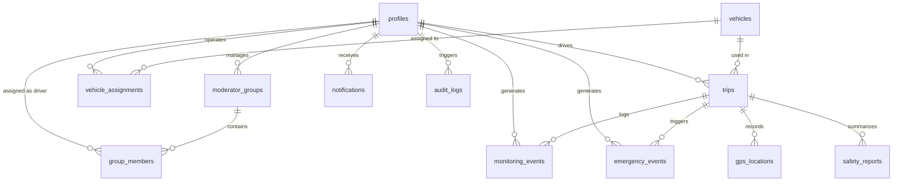

# SAFE GUARD: Database Architecture, Relationships & Security Documentation

This document describes the PostgreSQL database schema, relational constraints, Row Level Security (RLS) policies, and data isolation mechanisms used in **SAFE GUARD**.

---

## 1. Relational Entity-Relationship Diagram



---

## 2. Table Specifications (All 12 Tables)

### Table 1: `profiles`
User identity and role management, linked to Supabase `auth.users(id)`.
- `id` (UUID, Primary Key, Foreign Key $\rightarrow$ `auth.users.id` ON DELETE CASCADE)
- `email` (TEXT, Unique, Not Null)
- `full_name` (TEXT, Not Null)
- `role` (ENUM: `'driver'`, `'moderator'`, `'admin'`, Default `'driver'`)
- `phone` (TEXT)
- `avatar_url` (TEXT)
- `preferred_language` (VARCHAR(5), Default `'en'`)
- `is_active` (BOOLEAN, Default `true`)
- `created_at`, `updated_at` (TIMESTAMPTZ)

### Table 2: `moderator_groups`
Supervisory groups mapping one fleet moderator to a cluster of transit drivers.
- `id` (UUID, Primary Key, Default `uuid_generate_v4()`)
- `name` (TEXT, Not Null)
- `description` (TEXT)
- `moderator_id` (UUID, Foreign Key $\rightarrow$ `profiles.id` ON DELETE RESTRICT)
- `max_drivers` (INT, Default 50, CHECK between 10 and 50)
- `created_at`, `updated_at` (TIMESTAMPTZ)

### Table 3: `group_members`
Junction table assigning drivers to moderator groups.
- `id` (UUID, Primary Key)
- `group_id` (UUID, Foreign Key $\rightarrow$ `moderator_groups.id` ON DELETE CASCADE)
- `driver_id` (UUID, Foreign Key $\rightarrow$ `profiles.id` ON DELETE CASCADE)
- `assigned_at` (TIMESTAMPTZ)
- *Constraint*: `UNIQUE(group_id, driver_id)`

### Table 4: `vehicles`
Public transit buses and fleet inventory.
- `id` (UUID, Primary Key)
- `plate_number` (VARCHAR(20), Unique, Not Null)
- `make` (VARCHAR(50), Not Null)
- `model` (VARCHAR(50), Not Null)
- `year` (INT, Not Null)
- `capacity` (INT, Default 40)
- `status` (ENUM: `'active'`, `'maintenance'`, `'inactive'`)
- `current_odometer_km` (NUMERIC(10, 2), Default 0.0)
- `created_at`, `updated_at` (TIMESTAMPTZ)

### Table 5: `vehicle_assignments`
Pairing records between drivers and transit vehicles.
- `id` (UUID, Primary Key)
- `vehicle_id` (UUID, Foreign Key $\rightarrow$ `vehicles.id` ON DELETE CASCADE)
- `driver_id` (UUID, Foreign Key $\rightarrow$ `profiles.id` ON DELETE CASCADE)
- `start_time` (TIMESTAMPTZ)
- `end_time` (TIMESTAMPTZ, Nullable)
- `is_active` (BOOLEAN, Default `true`)
- `assigned_by` (UUID, Foreign Key $\rightarrow$ `profiles.id`)

### Table 6: `trips`
Lifecycle tracking for transit routes and active dispatches.
- `id` (UUID, Primary Key)
- `driver_id` (UUID, Foreign Key $\rightarrow$ `profiles.id`)
- `vehicle_id` (UUID, Foreign Key $\rightarrow$ `vehicles.id`)
- `route_name` (VARCHAR(100), Not Null)
- `start_location` (VARCHAR(200), Not Null)
- `end_location` (VARCHAR(200))
- `start_time`, `end_time` (TIMESTAMPTZ)
- `status` (ENUM: `'scheduled'`, `'in_progress'`, `'completed'`, `'cancelled'`)
- `total_distance_km` (NUMERIC(8, 2))
- `final_safety_score` (NUMERIC(5, 2), CHECK between 0 and 100)

### Table 7: `monitoring_events`
High-frequency AI fatigue telemetry emitted during trips.
- `id` (UUID, Primary Key)
- `trip_id` (UUID, Foreign Key $\rightarrow$ `trips.id` ON DELETE CASCADE)
- `driver_id` (UUID, Foreign Key $\rightarrow$ `profiles.id` ON DELETE CASCADE)
- `event_type` (VARCHAR(50): `'DROWSY'`, `'HIGHLY_DROWSY'`, `'YAWN'`, `'DISTRACTED'`, `'SEATBELT_UNBUCKLED'`)
- `safety_state` (ENUM: `'ALERT'`, `'DROWSY'`, `'HIGHLY DROWSY'`)
- `ear_value`, `mar_value` (NUMERIC(4, 3))
- `pitch_angle`, `yaw_angle` (NUMERIC(5, 2))
- `cnn_confidence` (NUMERIC(4, 3))
- `seat_belt_detected` (BOOLEAN)
- `timestamp` (TIMESTAMPTZ)

### Table 8: `emergency_events`
Critical safety and suspected health collapse incidents.
- `id` (UUID, Primary Key)
- `trip_id` (UUID, Foreign Key $\rightarrow$ `trips.id`)
- `driver_id` (UUID, Foreign Key $\rightarrow$ `profiles.id`)
- `event_type` (VARCHAR(50): `'suspected_collapse'`, `'abnormal_motion'`, `'prolonged_inactivity'`)
- `severity` (ENUM: `'low'`, `'medium'`, `'high'`, `'critical'`)
- `status` (ENUM: `'active'`, `'acknowledged'`, `'resolved'`)
- `trigger_source` (VARCHAR(50))
- `description` (TEXT)
- `acknowledged_by` (UUID, Foreign Key $\rightarrow$ `profiles.id`)
- `resolved_by` (UUID, Foreign Key $\rightarrow$ `profiles.id`)
- `resolution_notes` (TEXT)
- `timestamp` (TIMESTAMPTZ)

### Table 9: `gps_locations`
Geolocation telemetry points.
- `id` (UUID, Primary Key)
- `trip_id` (UUID, Foreign Key $\rightarrow$ `trips.id`)
- `vehicle_id` (UUID, Foreign Key $\rightarrow$ `vehicles.id`)
- `driver_id` (UUID, Foreign Key $\rightarrow$ `profiles.id`)
- `latitude`, `longitude` (NUMERIC(10, 7))
- `speed_kmh`, `heading` (NUMERIC(5, 2))
- `timestamp` (TIMESTAMPTZ)

### Table 10: `safety_reports`
Post-trip compiled driving score summaries.
- `id` (UUID, Primary Key)
- `trip_id`, `driver_id` (UUID)
- `overall_score` (NUMERIC(5, 2))
- `total_drowsy_events`, `total_distraction_events`, `total_emergency_events` (INT)
- `trip_duration_minutes` (INT)
- `summary_notes` (TEXT)
- `generated_at` (TIMESTAMPTZ)

### Table 11: `notifications`
Real-time push alerts to moderators and administrators.
- `id` (UUID, Primary Key)
- `recipient_id`, `sender_id` (UUID)
- `title`, `title_te` (VARCHAR(150))
- `message`, `message_te` (TEXT)
- `priority` (ENUM: `'low'`, `'medium'`, `'high'`, `'critical'`)
- `is_read` (BOOLEAN, Default `false`)

### Table 12: `audit_logs`
Security compliance records of all administrative actions.
- `id` (UUID, Primary Key)
- `user_id` (UUID, Foreign Key $\rightarrow$ `profiles.id`)
- `action` (VARCHAR(100))
- `resource` (VARCHAR(100))
- `ip_address` (VARCHAR(50))
- `timestamp` (TIMESTAMPTZ)

---

## 3. Row Level Security (RLS) Policy Specifications

### Helper SQL Functions
```sql
CREATE OR REPLACE FUNCTION auth.is_admin() RETURNS BOOLEAN AS $$
  SELECT EXISTS (SELECT 1 FROM profiles WHERE id = auth.uid() AND role = 'admin');
$$ LANGUAGE sql STABLE SECURITY DEFINER;

CREATE OR REPLACE FUNCTION auth.is_moderator_for_driver(driver_uuid UUID) RETURNS BOOLEAN AS $$
  SELECT EXISTS (
    SELECT 1 FROM group_members gm
    JOIN moderator_groups mg ON gm.group_id = mg.id
    WHERE mg.moderator_id = auth.uid() AND gm.driver_id = driver_uuid
  );
$$ LANGUAGE sql STABLE SECURITY DEFINER;
```

### Policy Enforcement Rules
1. **Drivers**:
   - `SELECT`, `INSERT`, `UPDATE` allowed strictly on records where `driver_id = auth.uid()`.
   - Cannot view other drivers' monitoring events, trips, or reports.
2. **Moderators**:
   - `SELECT` allowed on `profiles`, `trips`, `monitoring_events`, `emergency_events` where `auth.is_moderator_for_driver(driver_id)` evaluates to `true`.
   - `UPDATE` allowed on `emergency_events` to set `acknowledged_at` and `resolution_notes`.
   - Access to unassigned drivers is rejected at the database level.
3. **Administrators**:
   - `ALL` operations permitted across all 12 tables (`USING (auth.is_admin())`).

