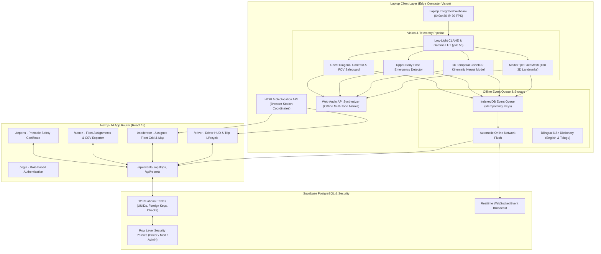

# SAFE GUARD: System Architecture & Technical Specifications

**Project Title**: AI-Based Intelligent Driver Safety, Health Emergency and Real-Time Vehicle Monitoring System for Public Transportation  
**System Name**: SAFE GUARD  
**Target Environment**: Laptop Web Browser (Next.js 14 App Router, Vercel-ready, Supabase Backend)

---

## 1. High-Level System Architecture

---

## 2. Core Architectural Principles

1. **Zero External Hardware Dependency**:
   - The entire solution executes on an ordinary student laptop.
   - External hardware (ECG sensors, pulse oximeters, OBD-II dongles, microcontrollers) is strictly excluded.
   - Medical emergency indicators (sudden collapse, convulsion/abnormal motion, unresponsiveness) are computed purely from webcam upper-body geometric kinetics.

2. **Client-Side Heavy, Serverless-Friendly**:
   - Video frame decoding, optical landmark extraction, and neural network inference execute client-side in the browser via WebAssembly (MediaPipe) and WebGL (TensorFlow.js).
   - Next.js serverless functions are reserved for lightweight database queries, event logging, and report compilation, maintaining 100% Vercel compatibility.

3. **Offline Fault-Tolerance**:
   - Audio alarms utilize the browser's native `AudioContext` oscillator, operating without internet access or external audio files.
   - Events occurring during network dropouts are buffered in an IndexedDB queue with idempotency keys, automatically re-synchronizing when connectivity is restored.

4. **Multi-Tenant Role-Based Isolation**:
   - Drivers only have access to their personal active trip and historical monitoring events.
   - Fleet Moderators are strictly restricted to assigned groups of 10–50 drivers.
   - Administrators possess organization-wide authority for fleet registration, vehicle assignments, and audit logging.

5. **First-Class Bilingual Localization**:
   - Centralized dictionary architecture supporting English and Telugu (`te`) without requiring page refreshes.
   - Typography rendered with Noto Sans Telugu to prevent layout breaking or text clipping.

